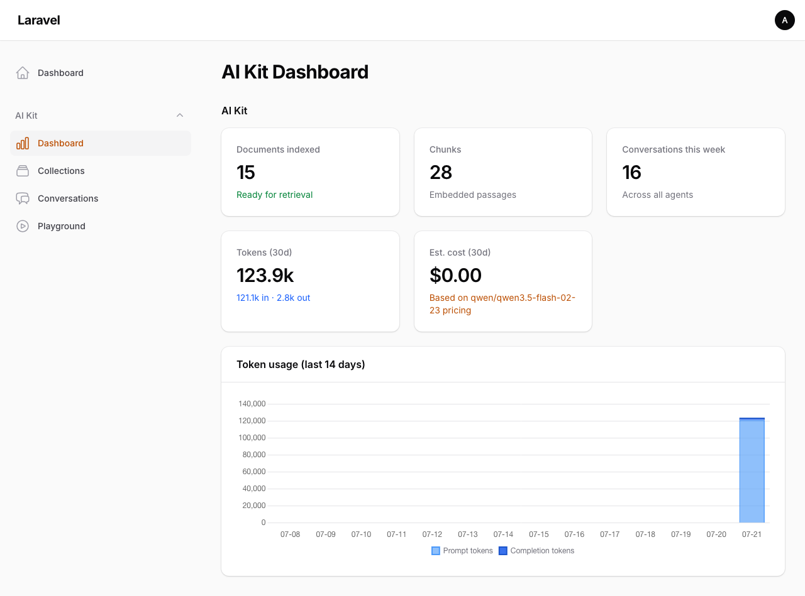
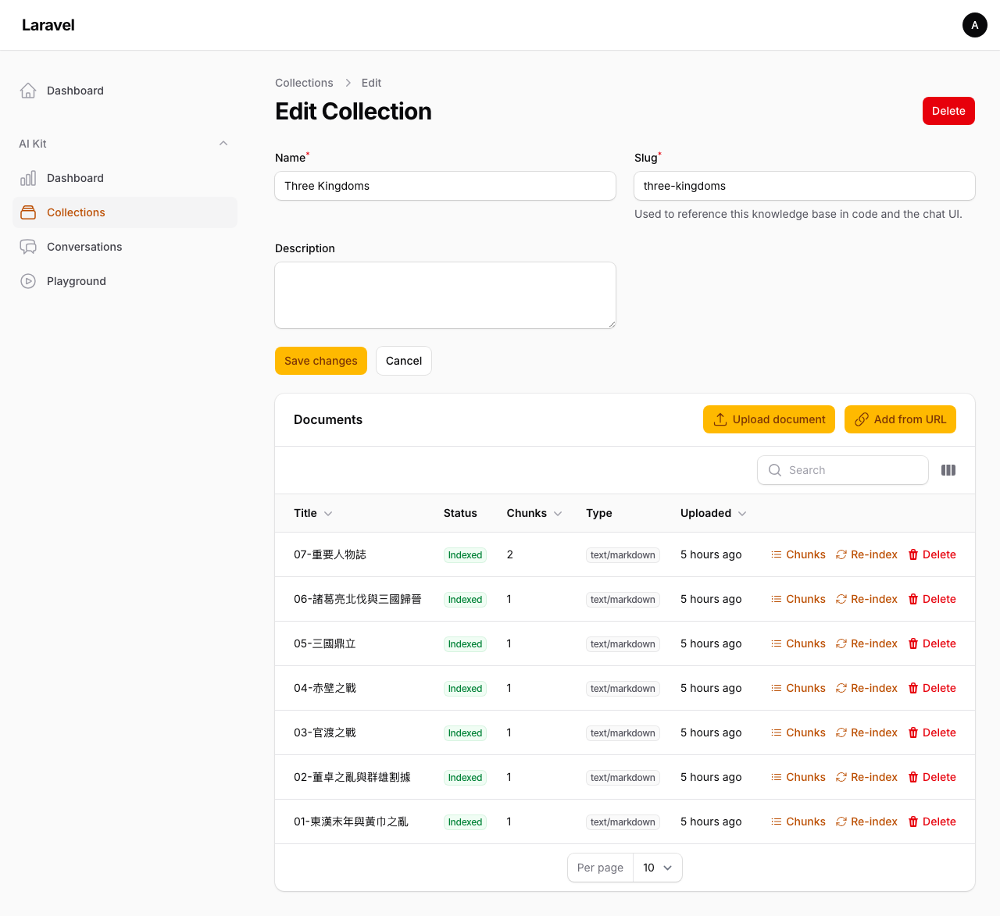
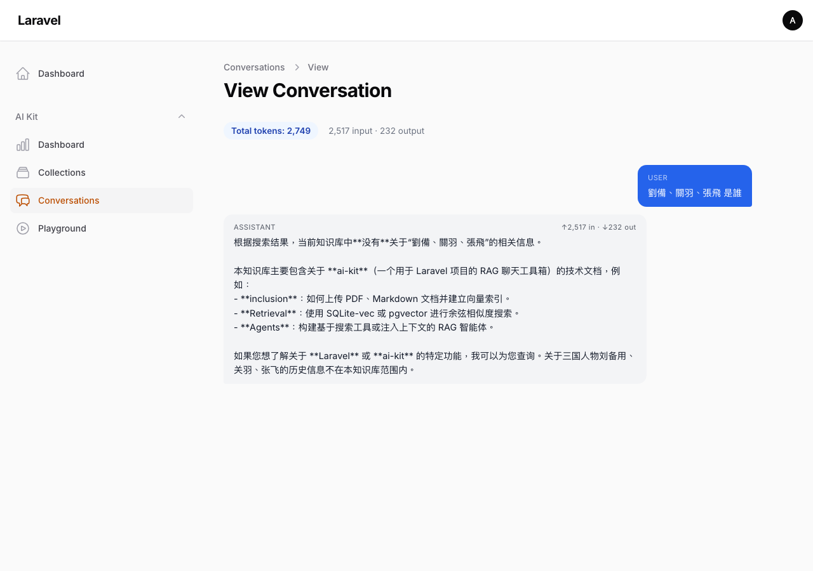
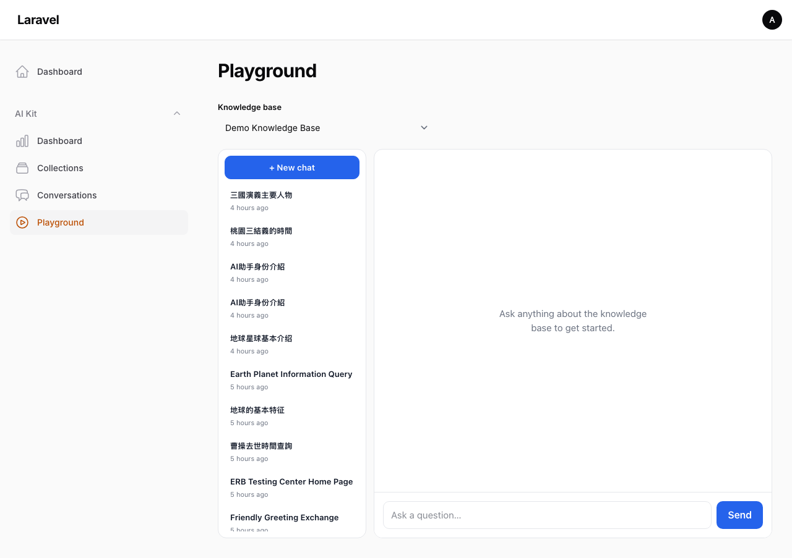

# ai-kit-filament


**The Filament admin panel for the ai-kit suite** — manage knowledge bases and documents, ingest files and URLs, review conversations with token usage, demo the chat in a Playground, and watch usage on an analytics dashboard.

<p align="center">
  
</p>

## Why this package?

Give your team (or clients) a no-code way to run the whole RAG pipeline: create
knowledge bases, upload PDFs/Word/Excel or add URLs, watch documents get indexed,
inspect the actual chunks, replay conversations with token usage, demo the chat
live, and track cost — all inside your existing Filament panel. One `->plugin()`
call, no controllers or Blade to write.

## Requirements

- PHP **8.5+**, Laravel **12 or 13**
- **Filament v5** (Livewire 4)
- `freddymx/ai-kit-core` and `freddymx/ai-kit-ui-livewire`

## Install

```bash
composer require freddymx/ai-kit-filament
```

Register the plugin on your panel:

```php
use SolutionForest\AiKit\Filament\AiKitPlugin;

public function panel(Panel $panel): Panel
{
    return $panel
        // ...
        ->plugin(AiKitPlugin::make());
}
```

Everything appears under an **AI Kit** navigation group.

## Migrating from `solution-forest/ai-kit-filament`

Up to 0.2 this package was `solution-forest/ai-kit-filament`; from 0.3 it is
`freddymx/ai-kit-filament`. The PHP namespace `SolutionForest\AiKit\` and the
`AiKitPlugin` class are unchanged.

```bash
composer remove solution-forest/ai-kit-filament solution-forest/ai-kit-ui-livewire solution-forest/ai-kit-core
composer require freddymx/ai-kit-filament:^0.4
```

The new package pulls `freddymx/ai-kit-core:^0.4` and
`freddymx/ai-kit-ui-livewire:^0.4` transitively. The old `solution-forest/*`
packages remain on Packagist at v0.2.x.

## What you get

### Collections + Documents (inline)

A **Collections** resource. Open a collection to manage its **Documents** inline (relation manager):

- **Upload** — pdf, txt, md, html, **Word (.docx)**, **Excel (.xlsx)**
- **Add from URL** — fetch + ingest a web page
- **View chunks** — inspect the embedded passages of any document
- **Re-index** / **Delete**
- status badge (pending / processing / indexed / failed) + chunk count

<p align="center">
  
</p>

### Conversations (read-only) with token usage

A log viewer of every conversation. The list shows **total tokens (in / out)** per conversation; open one to see the message thread with **per-message input/output tokens**.

<p align="center">
  
</p>

### Playground

A demo page: pick a knowledge base and chat live against it — the same Livewire component your app embeds. Ideal for client demos.

<p align="center">
  
</p>

### Analytics dashboard

A dedicated **Dashboard** page (under AI Kit, not the panel's default dashboard): documents indexed, chunks, conversations this week, **tokens (30d)**, **estimated cost (30d)**, and a **prompt vs. completion tokens-per-day** chart.

### AI settings

Open **AI Kit → AI Settings** in your panel (route `/admin/ai-settings` in the
default setup). The page edits the single `ai_kit_settings` row owned by the
core's `AiProviderResolver` — the same values the ingestion, chat, retrieval and
agents use.

- **Chat** — `chat_provider` + `chat_model`. The provider list includes `local`
  (the OpenAI-compatible sentinel) and the hosted providers supported by the AI
  SDK.
- **Embeddings** — `embeddings_provider`, `embeddings_model` and
  `embeddings_dimensions` (vector size; keep it in sync with your vector column).
- **Local provider** — shown only when either provider is `local`: `local_driver`
  (`openai-compatible` or `ollama`), `local_url` (required in that case),
  `local_key` (stored encrypted; the field shows a masked value and **Leave
  blank to keep the current key**), `local_chat_model`,
  `local_embeddings_model` and `local_embeddings_dimensions`. This is what you
  point at Ollama, LM Studio, llama.cpp or vLLM.
- **Effective value origins** — a live table showing, per key, whether the value
  comes from the **database** or from **env**, plus the effective value (the key
  stays masked).

**Precedence:** a non-null value in `ai_kit_settings` always wins over
`config/ai-kit.php` (and therefore over `.env`). A blank/unset field keeps using
the existing value. **Save** upserts the single row; **Reset to .env** (with
confirmation) deletes it, so every setting immediately falls back to `.env`.

## Optional features

Toggle in `config/ai-kit.php` (or `.env`):

```php
'features' => [
    'dashboard'   => env('AI_KIT_DASHBOARD', true),    // register the Dashboard page
    'token_usage' => env('AI_KIT_TOKEN_USAGE', true),  // token columns, per-message tokens, dashboard token stats + chart + cost
    'settings'    => env('AI_KIT_SETTINGS', true),     // register the AI Settings page
],
```

- `dashboard=false` → the Dashboard page + route are not registered.
- `token_usage=false` → all token/cost UI is hidden (conversation column, per-message tokens, dashboard token stats and chart).
- `settings=false` → the AI Settings page + route are not registered. This flag
  only gates the Filament page: the core resolver keeps working with `.env`
  values (or any overrides already saved in the database).

### Cost estimates

Cost = logged tokens × `config('ai-kit.pricing')` ($ per 1M input / output, per model), based on the active chat model. Add a rate entry for the model you use:

```php
'pricing' => [
    'google/gemini-2.5-flash' => ['input' => 0.30, 'output' => 2.50],
    // unlisted models → 'default' (0)
],
```

## The ai-kit suite

| Package | Purpose |
| --- | --- |
| [freddymx/ai-kit-core](https://github.com/freddymx/ai-kit-core) | Ingestion, retrieval, agents + CLI, HTTP API, MCP |
| [freddymx/ai-kit-ui-livewire](https://github.com/freddymx/ai-kit-ui-livewire) | Livewire 4 chat component |
| **freddymx/ai-kit-filament** (this) | Filament v5 admin panel |

The panel is one of **four faces** over the same core — everything here is also
scriptable via the CLI, callable over the HTTP API, or exposed to AI agents via
MCP (all in `ai-kit-core`).

## Upgrading from ai-kit 0.2

This package is part of the **0.3 breaking release** of the ai-kit suite: PHP
**8.5+**, Filament **^5.11**, Pest **5**, `ai-kit-core` and
`ai-kit-ui-livewire` at `^0.3`, and `dev-main` aliased to `0.3.x-dev`. Upgrade
the whole suite in lockstep.

The Laravel AI SDK v1 schema replaced `user_id` with `participant_type` /
`participant_id`; the Conversations resource was updated accordingly. Per-message
tokens now come from `input_tokens` / `output_tokens`, with legacy
`prompt_tokens` / `completion_tokens` rows still counted. Publish and run core's
AI SDK backfill migration on existing databases before deploying — see the
[core upgrade notes](https://github.com/freddymx/ai-kit-core#upgrading-from-ai-kit-02-ai-sdk-0x--1x).

## Continuous integration

`.github/workflows/tests.yml` runs the suite on a GitHub **release** (and manual
dispatch) — not on every push. `composer.json` declares local **path**
repositories at `../ai-kit-core` and `../ai-kit-ui-livewire` so cross-package
changes can be tested together, so CI clones both siblings first. The packages
themselves are published on Packagist as `freddymx/ai-kit-*`; the clone steps are
only about the local path repos and can be dropped together with them.

## Author

Created and maintained by **Alfredo Pineda** (<freddy@canariasnetworks.com>).
Originally published under the [SolutionForest](https://www.solutionforest.com)
organization; from 0.3 on, published in the `freddymx` Packagist namespace.

## License

MIT © [SolutionForest](https://www.solutionforest.com), Alfredo Pineda
